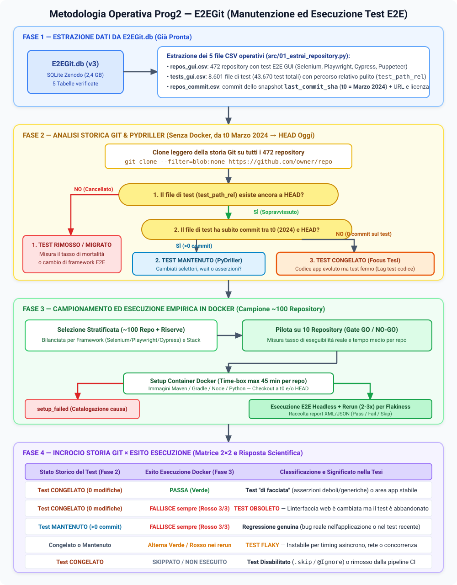
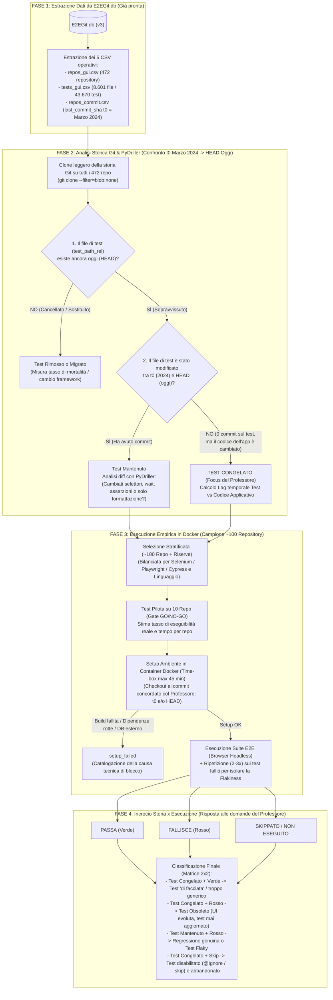

# Metodologia Operativa del Progetto (Prog2 — E2EGit) e Concetti Chiave

Questo documento riassume il flusso metodologico completo per svolgere il tirocinio sul dataset **E2EGit** (senza dipendere da tool esterni come PT-LINTR) e chiarisce due concetti tecnici fondamentali per il progetto: il clone parziale **`--filter=blob:none`** e la **Flakiness** dei test E2E.

---

## 1. Diagramma della Metodologia (4 Fasi)



### Schema testuale rapido (per lettura nel codice sorgente `.md`)

```text
+-----------------------------------------------------------------------------------+
| FASE 1: ESTRAZIONE DATI DA E2EGit.db (Già pronta)                                 |
+-----------------------------------------------------------------------------------+
  [ E2EGit.db (v3) ]
         |
         v
  Estrazione dei 5 file CSV operativi:
  - repos_gui.csv    --> 472 repository con test E2E GUI
  - tests_gui.csv    --> 8.601 file di test (43.670 test totali) con test_path_rel
  - repos_commit.csv --> last_commit_sha (t0 = Marzo 2024) + metadati repository
         |
         v
+-----------------------------------------------------------------------------------+
| FASE 2: ANALISI STORICA GIT & PYDRILLER (Senza Docker, da t0 Marzo 2024 a HEAD)   |
+-----------------------------------------------------------------------------------+
  Clone leggero della storia Git su tutti i 472 repo:
  $ git clone --filter=blob:none https://github.com/<owner>/<repo>
         |
         v
  [ DOMANDA 1: Il file di test (test_path_rel) esiste ancora oggi (HEAD)? ]
         |
         +--- NO (Cancellato / Spostato) ---> [ 1. TEST RIMOSSO O MIGRATO ]
         |                                    (Misura mortalità dei test / cambio framework)
         |
         +--- SÌ (Sopravvissuto)
                |
                v
         [ DOMANDA 2: Il file di test ha subito commit tra t0 (2024) e HEAD (oggi)? ]
                |
                +--- SÌ (Modificato) -------> [ 2. TEST MANTENUTO ]
                |                             (PyDriller: cambiati selettori, wait o assert?)
                |
                +--- NO (0 commit sul test, -> [ 3. TEST CONGELATO (Target Principale) ]
                     ma l'app è cambiata)     (Calcolo Lag temporale Test vs Codice App)
                        |
                        v
+-----------------------------------------------------------------------------------+
| FASE 3: CAMPIONAMENTO ED ESECUZIONE EMPIRICA IN DOCKER (Campione ~100 Repository) |
+-----------------------------------------------------------------------------------+
  Selezione Stratificata (~100 Repo + Riserve)
  (Bilanciata per Selenium / Playwright / Cypress e Java / JS / TS / Python)
         |
         v
  [ Test Pilota su 10 Repo (Gate GO/NO-GO) ] --> Stima eseguibilità reale e tempi
         |
         v
  [ Setup Ambiente in Container Docker (Time-box max 45 minuti per repo) ]
  (Checkout al commit concordato col Professore: t0 e/o HEAD)
         |
         +--- Build fallita / Dipendenze rotte / DB esterno ---> [ SETUP_FAILED ]
         |                                                       (Documenta causa blocco)
         +--- Setup OK
                |
                v
         [ Esecuzione Suite E2E (Browser Headless) ]
         + Riesecuzione (2-3 volte) dei soli test falliti per isolare la Flakiness
                |
                v
+-----------------------------------------------------------------------------------+
| FASE 4: INCROCIO STORIA GIT x ESITO ESECUZIONE (Matrice 2x2 — Risultati Tesi)     |
+-----------------------------------------------------------------------------------+
  Esito esecuzione test:  [ PASSA (Verde) ]   /   [ FALLISCE (Rosso) ]   /   [ SKIP ]
                                   |
                                   v
  +------------------------+------------------------+----------------------------------+
  | Stato Storico del Test | Esito Esecuzione       | Interpretazione Scientifica      |
  +------------------------+------------------------+----------------------------------+
  | Test CONGELATO         | PASSA (Verde)          | Test "di facciata" / generico    |
  |                        |                        | (o area dell'app mai toccata)    |
  +------------------------+------------------------+----------------------------------+
  | Test CONGELATO         | FALLISCE (Rosso 3/3)   | TEST OBSOLETO                    |
  |                        |                        | (UI cambiata, test abbandonato)  |
  +------------------------+------------------------+----------------------------------+
  | Test MANTENUTO         | FALLISCE (Rosso 3/3)   | Regressione genuina nel codice   |
  +------------------------+------------------------+----------------------------------+
  | Qualsiasi              | Alterna Verde / Rosso  | TEST FLAKY (Instabile / Timing)  |
  +------------------------+------------------------+----------------------------------+
  | Test CONGELATO         | SKIPPATO               | Test disabilitato (@Ignore/.skip)|
  |                        |                        | e dimenticato nel repository     |
  +------------------------+------------------------+----------------------------------+
```

### B) Diagramma Mermaid (per l'anteprima grafica Markdown `Ctrl+Shift+V`)



---

## 2. Spiegazione Passo-Passo delle 4 Fasi e di Tutte le Categorie di Test

L'obiettivo del tirocinio (`ProgTirocinio.txt`) è: **"eseguire i test e verificare perché non sono cambiati, se reggono o si sono rotti"**.  
Per rispondere non basta lanciare i test oggi: bisogna mettere insieme **cosa è successo al file di test su Git** (Fase 2) con **cosa succede quando lo eseguiamo nel browser** (Fase 3).

---

### PASSO 1 (Fase 1) — Il punto di partenza nel tempo: `t0` (Marzo 2024)
Nel database `E2EGit.db` (e nei CSV estratti), ogni repository ha un commit preciso salvato nella colonna `last_commit_sha` di `repos_commit.csv`. Quel commit risale a **marzo 2024** e lo chiamiamo **`t0`**.
A quel momento `t0`, nel dataset erano presenti **472 repository** e **8.601 file di test GUI** (`tests_gui.csv`).

---

### PASSO 2 (Fase 2) — Cosa è successo ai test sulla storia Git tra `t0` (Marzo 2024) e `HEAD` (Oggi)?
Prima di eseguire qualsiasi test, cloniamo la storia Git leggera (`--filter=blob:none`) e controlliamo cosa è successo a ciascuno degli 8.601 file di test dal commit `t0` (marzo 2024) fino all'ultimo commit di oggi (`HEAD`). Ogni file di test cade in una di queste **3 categorie storiche**:

#### 1. 🗑️ Test Rimosso o Migrato (Cancellato tra `t0` e `HEAD`)
* **Cosa significa**: Nel marzo 2024 il file di test (es. `tests/cypress/login.cy.js`) esisteva, ma se guardiamo il repository oggi (`HEAD`) **quel file non esiste più**.
* **Perché succede**:
  1. Il team ha **cambiato framework** (es. ha buttato via tutti i test Cypress per riscriverli in Playwright in un'altra cartella, come successo in `10up/elasticpress`).
  2. I test E2E erano diventati troppo difficili da mantenere e il team ha deciso di **eliminarli del tutto** (come successo in `Agenta-AI/agenta`).
* **Come lo misuri**: Con `git log --follow` dal commit `t0` a `HEAD`.

#### 2. 🔧 Test Mantenuto (Sopravvissuto e Modificato tra `t0` e `HEAD`)
* **Cosa significa**: Il file di test esiste ancora oggi ed **ha ricevuto almeno 1 commit di modifica** tra marzo 2024 e oggi, di pari passo con l'evoluzione dell'applicazione web.
* **Cosa andiamo a guardare (con PyDriller)**: Guardiamo il `git diff` per capire *come* gli sviluppatori lo hanno mantenuto:
  * Hanno aggiornato i **selettori HTML/CSS** (es. un bottone è cambiato da `#login-btn` a `[data-testid="submit-login"]`)?
  * Hanno aggiunto o modificato le **asserzioni** (`expect(...)`, `assert...`) perché la logica della pagina è cambiata?
  * Oppure hanno solo cambiato i tempi di attesa (`wait(1000)` $\rightarrow$ `wait(3000)`) o formattato il codice con Prettier/ESLint (manutenzione superficiale)?

#### 3. 🧊 Test Congelato (Sopravvissuto ma con ZERO modifiche tra `t0` e `HEAD`)
* **Cosa significa**: È il **vero oggetto della domanda del professore (*"perché i test non sono cambiati?"*)**. Il file di test esiste ancora oggi nel repository, è **identico riga per riga a com'era nel marzo 2024** (`0 commit` sul file di test), **mentre il resto dell'applicazione web è andato avanti** (decine o centinaia di commit sul codice sorgente).
* **Il dubbio scientifico**: Se l'applicazione web è cambiata per due anni ma il test E2E non è mai stato toccato, **come fa quel test a essere ancora valido?** Regge ancora o si è rotto? Per scoprirlo dobbiamo passare alla Fase 3 (eseguirlo) e alla Fase 4 (classificarlo).

---

### PASSO 3 (Fase 3) — L'esecuzione pratica in Docker (Pilota $\rightarrow$ Setup $\rightarrow$ Run)
Prendiamo un campione stratificato di repository (partendo da un **pilota di 10 repository** per vedere quanti partono davvero) e proviamo a eseguire i test dentro un container Docker (con browser Chrome/Firefox in modalità *headless*, cioè senza interfaccia grafica a schermo). Qui nascono gli stati di esecuzione:

* **`setup_failed` (Setup Fallito)**:
  * **Cosa significa**: Non riusciamo nemmeno a far partire i test (entro i 45 minuti di *time-box*), perché il progetto non compila più (es. una libreria del 2022 non esiste più su npm/Maven), oppure richiede servizi esterni non inclusi (es. un database Oracle proprietario, chiavi API a pagamento di AWS/OpenAI senza le quali l'app crasha all'avvio).
* **Esecuzione riuscita (`Pass` / `Fail` / `Skip`)**:
  * Il container parte, l'applicazione web si avvia e il framework (Selenium/Playwright/Cypress) esegue i test restituendo per ciascuno: **Verde (`PASSED`)**, **Rosso (`FAILED`)** o **Grigio (`SKIPPED`)**.
  * Sui test **Rossi (`FAILED`)**, rieseguiamo il test **2 o 3 volte di fila sullo stesso identico commit** per verificare se il fallimento è fisso (`3/3` rossi) o intermittente (*Flaky*).

---

### PASSO 4 (Fase 4) — Tutte le Categorie Finali (Incrocio Storia Git × Esecuzione)
Una volta che sappiamo sia la storia del test (Fase 2: *Congelato* vs *Mantenuto*) sia il risultato dell'esecuzione in Docker (Fase 3: *Verde*, *Rosso fisso*, *Rosso alternato*, *Skippato*), otteniamo le **5 categorie scientifiche finali** che spiegano il comportamento dei test E2E:

---

#### Categoria A: 🎭 Test "di Facciata" (Smoke Test generico)
* **Combinazione**: **Test Congelato** (0 modifiche in 2 anni) + **PASSA (🟢 Verde)**.
* **Cos'è e perché succede**: L'applicazione web è cambiata tantissimo in due anni, il test non è mai stato aggiornato, eppure quando lo lanciamo **passa ancora! Perché?**
  Ci sono solo due motivi possibili:
  1. **Area stabile**: Quel test controlla una pagina secondaria (es. la pagina *"Chi siamo"* o *"Termini di servizio"*) che non è mai stata toccata dagli sviluppatori.
  2. **Test "di facciata" (Superficiale / Debole)**: Il test passa solo perché **non controlla quasi nulla di specifico**. Ad esempio: apre `http://localhost:3000`, controlla soltanto che il titolo della pagina non sia vuoto o che lo status HTTP sia `200 OK` (oppure non ha nemmeno una vera asserzione `assert`/`expect`), senza testare i bottoni o i flussi che nel frattempo sono cambiati. Quindi il test non è mai cambiato perché è talmente generico che non si rompe mai, ma dà anche una **falsa sicurezza** agli sviluppatori.

---

#### Categoria B: 🏚️ Test Obsoleto (Rotto per mancata manutenzione)
* **Combinazione**: **Test Congelato** (0 modifiche in 2 anni) + **FALLISCE SEMPRE (🔴 Rosso 3 volte su 3)**.
* **Cos'è e perché succede**: Gli sviluppatori hanno modificato l'applicazione web (hanno cambiato il testo di un pulsante, spostato un menu, rinominato un `id` HTML o aggiunto un campo obbligatorio nel form di registrazione), ma **si sono dimenticati o hanno smesso di aggiornare il test E2E**.
* **Come lo riconosci dai log**: Quando lo esegui in Docker, il test fallisce sempre nello stesso punto con errori tipici di disallineamento con la UI:
  * `NoSuchElementException: Unable to locate element: #old-button-id` (il bottone è cambiato nell'app, ma il test cerca ancora il selettore vecchio).
  * `AssertionError: expected URL to contain '/dashboard-v1' but got '/app/home'` (la rotta dell'app è cambiata).
* **Perché nessuno se n'è accorto nel progetto?**: Spesso perché quel test E2E non viene più lanciato automaticamente nella Continuous Integration (GitHub Actions) a ogni commit, quindi si è rotto mesi fa e nessuno lo ha mai riparato.

---

#### Categoria C: 🐛 Regressione Genuina (Bug reale nell'applicazione)
* **Combinazione**: **Test Mantenuto** (aggiornato di recente) + **FALLISCE SEMPRE (🔴 Rosso 3 volte su 3)**.
* **Cos'è e perché succede**: Qui il test **non è stato abbandonato**: i selettori HTML sono giusti, il test trova i bottoni, compila il form correttamente come previsto dalla versione attuale dell'app, ma **l'applicazione restituisce un errore vero** (es. `500 Internal Server Error`, crash JavaScript in console, calcolo sbagliato nel carrello).
* **Differenza fondamentale con il Test Obsoleto**:
  * Nel **Test Obsoleto**, l'applicazione funziona benissimo, ma è il **test** che è rimasto indietro e cerca cose vecchie.
  * Nella **Regressione Genuina**, il **test ha ragione** e ha scoperto un vero bug introdotto dagli sviluppatori nel codice dell'applicazione.

---

#### Categoria D: 🎲 Test Flaky (Instabile / Non deterministico)
* **Combinazione**: **Test Congelato o Mantenuto** + **Esito Alternato nei Rerun (es. 🔴 Rosso alla 1ª prova, 🟢 Verde alla 2ª e 3ª prova sullo stesso commit)**.
* **Cos'è e perché succede**: Né il test né l'applicazione sono davvero "rotti" a livello logico, ma il test soffre di problemi di **sincronizzazione temporale (timing)**. Ad esempio clicca un pulsante prima che la chiamata AJAX al backend sia terminata o prima che si chiuda un'animazione CSS.
* **Perché è importante**: Se non facessimo i 2–3 rilanci di verifica, scambieremmo un test *Flaky* per un *Test Obsoleto* o una *Regressione*.

---

#### Categoria E: 🔇 Test Disabilitato e Dimenticato (Skipped / Ignored)
* **Combinazione**: **Test Congelato** + **SKIPPATO (⚪ Non eseguito dal runner)**.
* **Cos'è e perché succede**: Quando un test E2E inizia a fallire (perché è diventato *Obsoleto* o perché è *Flaky*), ripararlo richiede tempo. Molto spesso gli sviluppatori scelgono la scorciatoia: aggiungono un'annotazione nel codice per spegnerlo temporaneamente:
  * In JUnit / Java: `@Disabled` o `@Ignore`
  * In Cypress / Playwright / Mocha / Jest: `it.skip(...)`, `test.skip(...)` o `xdescribe(...)`
  * In PyTest: `@pytest.mark.skip`
* **Il fenomeno che misuri con PyDriller ("Età dello skip")**: Andando a ritroso nei commit con PyDriller, puoi calcolare **in quale data è stato aggiunto quel `.skip` o `@Ignore`**. Spesso scoprirai che una "disabilitazione temporanea" è lì da 2 o 3 anni: il test è rimasto nel repository come codice morto ("zombie test") e per questo non è mai più cambiato.

---

### Tabella Riassuntiva Rapida (da tenere sott'occhio al ricevimento)

| Nome Categoria | Storia Git (`t0` $\rightarrow$ `HEAD`) | Esito in Docker | Di chi è la "colpa"? | Cosa dimostra nella tesi |
|---|---|---|---|---|
| **🗑️ Rimosso / Migrato** | File cancellato | Non più presente a `HEAD` | Scelta del team | Alta mortalità dei test E2E o migrazione (es. Cypress $\rightarrow$ Playwright) |
| **🎭 Test di Facciata** | **Congelato** (0 commit) | 🟢 **Verde** (`3/3`) | Test troppo generico | Il test non cambia mai perché fa controlli banali che passano sempre |
| **🏚️ Test Obsoleto** | **Congelato** (0 commit) | 🔴 **Rosso fisso** (`3/3`) | **Test vecchio** (UI cambiata) | L'app è evoluta, ma il test cerca ancora selettori/flussi del 2024 |
| **🐛 Regressione Genuina** | **Mantenuto** (>0 commit) | 🔴 **Rosso fisso** (`3/3`) | **Bug nell'App** | Il test è aggiornato e funziona: ha scovato un vero errore nel software |
| **🎲 Test Flaky** | Congelato o Mantenuto | 🟡 **Alterna Verde/Rosso** | Timing / Asincronia | Il test ha attese fragili (`sleep`/race condition) e fallisce a caso |
| **🔇 Test Disabilitato** | **Congelato** (con `.skip`/`@Ignore`) | ⚪ **Skippato** | Debito tecnico | Quando il test si è rotto, il team lo ha spento invece di aggiornarlo |

---

## 3. Approfondimento Tecnico 1: Cosa significa `git clone --filter=blob:none`?

### Il problema pratico
In Git, un repository è composto da tre tipi principali di oggetti nel suo database interno:
- **Commit**: i metadati di chi ha fatto una modifica, quando, il messaggio di commit e il puntatore al commit precedente.
- **Tree (Alberi)**: la struttura delle cartelle e i nomi dei file presenti in ogni commit.
- **Blob (Binary Large Objects)**: il **contenuto vero e proprio di ogni singolo file** in tutte le versioni della storia del progetto.

Quando fai un normale `git clone https://github.com/owner/repo`, Git scarica sul tuo disco **tutti i commit, tutti i tree e tutti i blob di tutta la storia del progetto** (anni di codice, immagini, librerie committate per errore, ecc.).
Farlo per 472 repository grandi (che hanno almeno 2.000 commit ciascuno per via dei filtri di E2EGit) occuperebbe **tra i 150 GB e i 300 GB di disco** e richiederebbe ore di download.

### Come funziona `--filter=blob:none` (Blobless Clone)
Il comando:
```powershell
git clone --filter=blob:none https://github.com/owner/repo
```
esegue un **clone parziale ("blobless")**:
1. **Scarica subito tutta la storia dei Commit e dei Tree** (quindi conosci istantaneamente tutti i commit dal primo all'ultimo, le date, gli autori e quali file sono stati creati, modificati o cancellati in ogni commit).
2. **NON scarica il contenuto dei file (`blob`) storici**, tranne quelli necessari per il checkout corrente.
3. **Scarica i singoli `blob` "on-demand" (solo quando servono)**: quando chiedi a Git o a PyDriller il diff di uno specifico file di test (`git diff <sha> HEAD -- percorso/del/test.spec.js`), Git contatta automaticamente GitHub dietro le quinte e scarica **solo i pochi kilobyte di quel singolo file di test**, ignorando le migliaia di altri file del progetto.

### Perché è fondamentale nel tuo tirocinio?
| Caratteristica | `git clone` normale | `git clone --depth 1` (Shallow) | `git clone --filter=blob:none` (Blobless) |
|---|---|---|---|
| **Spazio su disco per 472 repo** | Enorme (150–300 GB) | Minimo, ma **senza storia** | **Pochissimi GB** (solo metadati + i file di test) |
| **Permette di usare PyDriller / `git log`?** | Sì, ma lentissimo da scaricare | ❌ **NO** (hai solo 1 commit, non vedi la storia) | ✅ **SÌ, hai tutta la storia completa da `t0` a `HEAD`** |
| **Velocità per analizzare i test** | Bassa | Non applicabile per la storia | **Altissima** (pochi secondi a repository) |

In breve: `--filter=blob:none` ti permette di analizzare la storia completa di tutti gli 8.601 file di test su 472 repository in poco tempo e senza riempire l'hard disk.

---

## 4. Approfondimento Tecnico 2: Cos'è la *Flakiness* (Test Flaky)?

### Definizione
Un test software si definisce **flaky** (instabile / intermittente) quando, **eseguito più volte sullo stesso identico codice sorgente (stesso commit) e nello stesso ambiente, a volte PASSA (🟢) e a volte FALLISCE (🔴)** in modo non deterministico, senza che nessuno abbia toccato una sola riga di codice.

### Perché nei test E2E GUI la Flakiness è altissima?
A differenza dei test unitari (che testano una funzione matematica in memoria in pochi millisecondi), i test E2E GUI (Selenium, Playwright, Cypress, Puppeteer) avviano un **browser reale**, caricano una pagina web, fanno chiamate di rete e simulano clic sugli elementi della pagina. Basta un minimo rallentamento per far fallire il test anche se l'applicazione funziona benissimo:

1. **Attese asincrone e Timing (`Async Wait` / Race Conditions)**:
   Il test clicca su *"Login"* e cerca subito dopo il bottone *"Dashboard"*. Se il server o il browser impiegano 1,2 secondi invece di 1,0 secondo a renderizzare la pagina (e lo sviluppatore ha messo un `sleep(1000)` fisso o un timeout troppo corto), il test fallisce con `ElementNotFoundException` o `TimeoutError`. Se lo rilanci un minuto dopo, il computer è meno carico, la pagina risponde in 0,8 secondi e il test **passa**.
2. **Animazioni CSS e rendering del DOM**:
   Il bottone esiste già nell'HTML ma sta ancora facendo una transizione/animazione di apertura: Selenium/Cypress prova a cliccarlo un millisecondo troppo presto e fallisce perché l'elemento è "coperto" o non ancora cliccabile.
3. **Concorrenza e stato sporco (Test Order Dependency)**:
   Due test girano in parallelo o in sequenza sullo stesso database locale: il Test A crea un utente `"mario"`, il Test B prova a creare `"mario"` e fallisce se il Test A non ha ancora finito di pulire il database.
4. **Risorse della macchina / Docker**:
   Quando fai girare Chrome/Firefox dentro un container Docker, un picco temporaneo di CPU o RAM rallenta il rendering JavaScript quel tanto che basta per far scattare i timeout dei test.

### Perché la Flakiness è un problema critico per i risultati della tua tesi?
Immagina di eseguire un repository una sola volta: su 50 test, **5 falliscono**.
Se non tieni conto della flakiness, potresti scrivere nella tesi: *"Questi 5 test si sono rotti perché il codice è cambiato e i test sono obsoleti"*.
Ma se li rilanci una seconda e una terza volta sullo stesso identico commit e scopri che **4 di quei 5 test passano**, allora **non erano test rotti/obsoleti**: erano **test flaky**!

### Come si gestisce nella tua pipeline (Fase 3)?
Non serve eseguire 5 volte tutti i 100 repository (sprecheresti settimane di tempo macchina). Si usa il protocollo a **due ondate**:
1. **Prima esecuzione (Ondata 1)**: Esegui la suite di test una volta. Se tutti i test sono verdi, hai finito.
2. **Riesecuzione mirata (Ondata 2 — Controllo Flakiness)**: Solo per i repository/test che hanno avuto un fallimento nell'Ondata 1, rilanci i test altre **2 o 3 volte** sullo stesso commit:
   - Se un test fallisce **sempre** (es. 3 volte su 3 con lo stesso errore) $\rightarrow$ è un **Fallimento Deterministico** (test realmente rotto/obsoleto o regressione).
   - Se un test passa alcune volte e fallisce altre (es. 1 rosso e 2 verdi) $\rightarrow$ lo classifichi nella categoria **`Flaky`**.

In più, la flakiness aiuta anche a spiegare **"perché alcuni test non cambiano o vengono disabilitati"**: molto spesso gli sviluppatori, stanchi di vedere un test E2E fallire a caso in CI per colpa della flakiness, ci mettono sopra `.skip` / `@Ignore` e smettono per sempre di mantenerlo.

